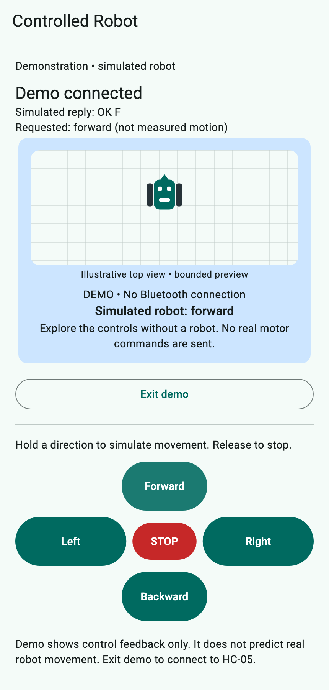

# Controlled Robot

[](https://github.com/kleberandrade/controlled-robot-arduino/actions/workflows/ci.yml)
[](https://docs.flutter.dev/)
[](app/pubspec.yaml)
[](https://docs.arduino.cc/hardware/uno-rev3/)
[](firmware/robot/Robot.h)
[](app/android/app/build.gradle.kts)
[](LICENSE)

Build a two-wheel Arduino robot controlled by a **Flutter Android app** over
HC-05 Bluetooth Classic SPP. Firmware starts stopped, accepts a tiny line
protocol, disables motors on invalid input and stops after 500 ms without valid
commands. Hold a direction to move; release or tap STOP to coast.

This repository includes firmware, an Android app, host behavior tests,
controller/widget tests, CI, and a [vector circuit](docs/circuit.svg).
No phone, radio, motor or physical robot has been tested here.

## Try the controls without a robot

Install the latest **build-4 release APK** from the
[same GitHub test release](https://github.com/kleberandrade/controlled-robot-arduino/releases/tag/v1.0.0-test.1),
open the app and tap **Start demo**. No pairing or Bluetooth permission is needed
for the demo. Hold Forward, Backward, Left or Right to see simulated command
feedback and an animated top-view robot. Forward/Backward follow the robot's
heading; Left/Right pivot in place. Release, cancel the touch or tap STOP to
freeze the robot at its current position. Tap **Exit demo**
to return to the real Bluetooth connection flow. Backgrounding also exits demo.
Disconnect an active or pending real connection before starting demo.

Demo uses in-memory protocol replies and never sends motor commands over
Bluetooth. It demonstrates the interface, not robot physics, sensors, radio
reliability or the Arduino watchdog. Real robot operation still requires the
documented hardware and firmware.

The preview stays inside its arena; reverse or turn to move away from an edge.
Exiting/restarting demo recenters it. Animation pauses when the system requests
reduced motion; command feedback remains available. Its illustrative distances,
turning rate and boundaries do not represent real motor speed or collision sensing.



*Automated capture of the production Flutter widgets while Forward is held in
demo mode; this is not a physical-phone screenshot.*

## Supported configuration

- Arduino Uno Rev3 (ATmega328P, 5 V), Arduino AVR core **1.8.8**,
  Arduino CLI **1.6.0**; SoftwareSerial is supplied by the core.
- HC-05 **Classic SPP**, regulated 5 V carrier with 3.3 V UART, slave data mode,
  9600 baud. Not an HM-10/BLE substitution.
- TB6612FNG dual driver; separate motor power, common ground, level divider.
- Android **7.0 / API 24 or later**, with Bluetooth Classic hardware.
- Flutter **3.41.9 stable**, Dart **3.11.5**; Gradle 8.14, Android Gradle Plugin
  8.11.1, Kotlin 2.2.20, Java 17 for Android builds, Android SDK 36.
- Maintained [`flutter_bluetooth_serial_plus` 0.5.7](https://pub.dev/packages/flutter_bluetooth_serial_plus),
  pinned with a committed dependency lockfile. Its generic SPP transport is
  Android-only; its iOS Zebra BLE feature does not make HC-05 work on iOS.

**iOS is unsupported.** Generic HC-05 SPP is not available through CoreBluetooth;
Apple's External Accessory route requires an appropriate MFi accessory. No iOS
project or Bluetooth permission claims are included.

## Requirements and installation

Install [Flutter](https://docs.flutter.dev/install), Android Studio/SDK, Java 17,
and [Arduino CLI](https://arduino.github.io/arduino-cli/installation/).
Run `flutter doctor` and accept the Android SDK licenses locally. For host tests,
install a C++11 compiler with AddressSanitizer and UndefinedBehaviorSanitizer
(Clang or GCC on macOS/Linux).

```sh
git clone https://github.com/kleberandrade/controlled-robot-arduino.git
cd controlled-robot-arduino
arduino-cli core update-index
arduino-cli core install arduino:avr@1.8.8
arduino-cli compile --fqbn arduino:avr:uno firmware/robot
cd app
flutter pub get --enforce-lockfile
flutter analyze
flutter test
flutter build apk --debug
```

For phone testing, download the smaller **release APK** from the
[GitHub test release](https://github.com/kleberandrade/controlled-robot-arduino/releases/tag/v1.0.0-test.1).
It is optimized, non-debuggable and signed with a dedicated local test-release
key. Android 7+ is required. If the older debug APK is installed, uninstall it
once before switching signing identities; uninstalling removes its local data.
Installation and pairing instructions are included in the release.

The command above builds a development APK at
`app/build/app/outputs/flutter-apk/app-debug.apk`, relative to the repository
root. For a signed release build, follow the [release signing guide](docs/ANDROID_RELEASE.md),
then run `flutter build apk --release` from `app/`. No store publishing is configured.

## Quick start

1. Read the [BOM, pin table, wiring, supply limits and circuit](docs/HARDWARE.md).
   Disconnect motor power during assembly and firmware upload.
2. Upload manually, replacing PORT with the Uno's actual serial port:
   `arduino-cli upload --fqbn arduino:avr:uno -p PORT firmware/robot`.
3. Pair HC-05 in **Android system Bluetooth settings**. Install and open the app.
4. Tap **Pair in Android settings** if pairing is needed, then return and tap
   **Refresh paired devices**. Grant the requested permissions, select the
   correct paired module and tap **Connect**.
5. Wait for `OK S` feedback. With wheels lifted, apply motor power and briefly
   hold Forward. Release to stop. Confirm wheel polarities before floor use.
6. Use Left/Right to pivot; Backward to reverse. STOP requests standby immediately.
   Disconnect or background the app to end the session. Reconnection never
   restores the previous movement.

The app lists paired devices; it does not silently connect to the first radio.
Pairing is delegated to Android settings. Phone pairing and RFCOMM connection
are separate steps. Feedback shows firmware acknowledgement, not measured motion.

## Android permissions

The host manifest explicitly bounds legacy permissions and retains the plugin's
runtime requirements:

| Android API | Manifest/runtime behavior |
| --- | --- |
| 24–30 | BLUETOOTH and BLUETOOTH_ADMIN; the plugin's permission helper also requests COARSE/FINE_LOCATION at runtime, even for the paired-list path. Allow location to use this plugin on these releases. |
| 31+ | BLUETOOTH_CONNECT and BLUETOOTH_SCAN runtime Nearby devices permission. SCAN is declared neverForLocation. Legacy and location permissions end at API 30. |

The app does not scan or track location. The dependency currently requires its
broader helper permissions; removing them would break that helper. Discovery,
if added later on older Android, also requires system location services.
Permission denial and disabled Bluetooth are reported in the UI. For permanent
denial, grant permissions in Android app settings, then retry refresh.
See [Android's permission guide](https://developer.android.com/develop/connectivity/bluetooth/bt-permissions).

## Protocol, examples and structure

[Protocol v1](docs/PROTOCOL.md) specifies exact bytes, responses, heartbeat,
malformed-frame handling and timeout behavior. The Flutter app is the runnable
controller example. Host tests provide executable examples without hardware.

- `firmware/robot/Robot.h`: pure parser, movement mapping and elapsed-time rules.
- `firmware/robot/robot.ino`: Uno pins, driver output and SoftwareSerial adapter.
- `app/lib/`: bounded reply parser, testable controller, SPP adapter and touch UI.
- `app/lib/demo_motion.dart` and `demo_robot.dart`: pure illustrative pose rules
  and a frame-driven, code-drawn robot used only in demo mode.
- `tests/`: firmware behavior tests; `app/test/`: Dart and widget behavior tests.
- `app/tool/capture_demo.dart`: repeatable Flutter capture for the README screen.
- `docs/`: circuit, assembly, protocol and [work log](docs/WORK_LOG.md).

## Tests and CI

```sh
./scripts/test-firmware.sh
arduino-cli compile --fqbn arduino:avr:uno --warnings all firmware/robot
cd app
dart format --output=none --set-exit-if-changed lib test tool
flutter analyze --fatal-infos
flutter test --coverage
flutter build apk --debug
```

CI runs host tests with sanitizers, builds Uno firmware, checks Dart formatting
and analysis, runs Flutter tests, and builds debug and release Android APKs.
The release check uses a disposable CI signing identity and verifies that the
APK is signed and non-debuggable. CI keys are never used for published APKs.
CI does not operate hardware. The badge reports the real workflow, not a static
success claim. See the work log for actual results and tool limitations.

To regenerate the screenshot, run from `app/`, replacing the SDK path:

```sh
ROBOT_FONT_DIR=/path/to/flutter/bin/cache/artifacts/material_fonts \
  flutter test tool/capture_demo.dart
```

This loads the SDK's Roboto/Material fonts, renders the actual app widgets at a
430×900 logical viewport and writes `docs/screenshots/demo-mode.png` at 2× scale.
The capture advances animation frames and checks that the robot has moved, then
verifies that releasing Forward returns to stop.

## Troubleshooting and limitations

- No devices: pair in system settings first; enable Bluetooth and grant permissions.
- Connects without OK S: verify module address, 9600 data baud, common ground,
  crossed TX/RX and divider; verify firmware upload. Release stale connections
  from other terminal apps. Only one controller should use the radio.
- Repeated disconnects: inspect interference/power sag. The app deliberately
  closes on firmware errors, blocked writes or absent feedback; reconnect manually.
- Wrong direction: switch off motor power and swap the affected motor terminals.
- Stop uses **coast/standby**, so inertia and slopes can keep the chassis moving.
  Use a physical motor-power switch. No braking-distance guarantee or watchdog
  guarantee for a frozen MCU, wiring fault, buffered radio traffic or failed driver.
- There is no obstacle detection, encoder telemetry, speed regulation, command
  authentication or replay protection. Default HC-05 PINs provide weak security.
  Keep operation local and supervised. Do not use around people or hazardous loads.
- The movement UI is intended for Android touch input; keyboard and assistive
  hold gestures need separate usability validation. Emulators do not validate SPP.

## License and credits

MIT, copyright © 2019 Kléber de Oliveira Andrade; see [LICENSE](LICENSE).
Dependency licenses remain with their authors. See [third-party notices](docs/THIRD_PARTY.md).
