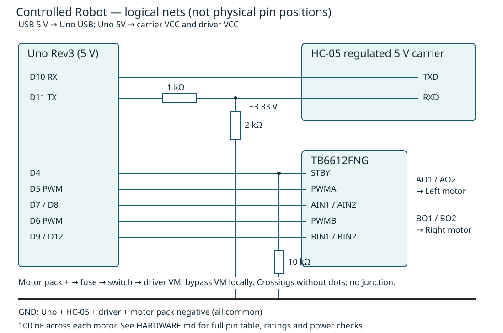

# Hardware, wiring and first power-on

## Reference build and bill of materials

- Arduino Uno Rev3 (ATmega328P, 5 V logic); USB cable and USB 5 V supply/power bank.
- HC-05 Bluetooth Classic SPP **carrier with a documented 5 V VCC regulator**,
  3.3 V UART, slave data mode at 9600 baud. A bare HC-05 is not a 5 V module.
  Confirm the exact carrier schematic/label before applying power.
- Pololu TB6612FNG dual motor driver carrier (or electrically equivalent carrier
  with its schematic checked). VCC=5 V, VM from a separate motor pack.
- Two geared DC motors rated for a 4×AA NiMH pack (nominal 4.8 V). Select motors
  whose **stall current is below 1 A per channel at the actual pack voltage**;
  allow thermal margin. The 3 A peak is not a continuous allowance.
- Chassis, two wheels, caster, switched/fused battery holder, suitable wires and
  soldered connectors; fuse chosen for the pack/wire/motor ratings.
- 1 kΩ and 2 kΩ resistors for the UART divider; 10 kΩ external STBY pull-down.
- 100 nF ceramic across each motor's terminals; local supply bypass capacitors
  per carrier documentation, with a bulk capacitor (e.g. 100 µF, suitably voltage
  rated) across VM/GND near the driver. Observe electrolytic polarity.

## Wiring

This is a logical net diagram, not a physical breadboard layout. Pin names on
carriers can differ. Power off all supplies before changing wiring.

| Source | Destination | Notes |
| --- | --- | --- |
| Uno D10 (software RX) | HC-05 TXD | 3.3 V TX into Uno RX |
| Uno D11 (software TX) | 1 kΩ → junction → HC-05 RXD | Junction → 2 kΩ → GND; approx. 3.33 V from 5 V |
| Uno 5V | HC-05 regulated carrier VCC; driver VCC | Never feed bare HC-05 supply with 5 V |
| Uno GND | HC-05 GND; driver GND; motor pack negative | All grounds common |
| Uno D4 | driver STBY | Add 10 kΩ from STBY to GND; keep disabled during reset |
| Uno D5 (PWM) | driver PWMA | Left speed |
| Uno D7 / D8 | driver AIN1 / AIN2 | Left polarity |
| Uno D6 (PWM) | driver PWMB | Right speed |
| Uno D9 / D12 | driver BIN1 / BIN2 | Right polarity |
| driver AO1 / AO2 | Left motor terminals | Swap terminals if forward is reversed |
| driver BO1 / BO2 | Right motor terminals | Swap terminals if forward is reversed |
| Motor pack + | Fuse → power switch → driver VM | Separate motor supply; never Uno 5V |
| USB supply | Uno USB connector | Do not connect motor pack + to Uno 5V |

HC-05 KEY/EN and STATE are unused; leave as required by the particular carrier
for normal data mode. Uno D0/D1 remain available for USB upload/debugging.
The 1 kΩ/2 kΩ divider belongs only on **Uno TX → HC-05 RX**, not the reverse.
Use short grounds, route motor current away from the radio/logic ground paths,
and mechanically secure the battery. Do not rely on a rectangular 9 V battery
for motor startup current. Use the pack and motor supplier's charging guidance.

## Pairing and acceptance procedure

1. With motor power disconnected, inspect continuity, polarity, divider and
   STBY pull-down. Upload firmware via USB. Reset must leave STBY low.
2. Power the HC-05 carrier correctly. In Android Bluetooth settings pair with
   its advertised name (often HC-05). PIN is commonly 1234 or 0000 but confirm
   with its supplier; change defaults where supported. Pairing is done by the OS.
3. Check slave/data mode and 9600 baud using the supplier's AT procedure if no
   acknowledgement arrives. Do not assume AT baud equals data baud.
4. Install the Flutter app, allow permissions, refresh paired devices, select
   the module, connect. Expect OK S before controls enable.
5. Lift and restrain the chassis, switch motor power on, briefly hold Forward
   then release. Confirm both motor polarities. Test pivots and Backward.
6. Verify release, STOP, disconnect, backgrounding, invalid serial frame, loss
   of radio and >500 ms without commands all leave motor enable low. Perform
   with wheels lifted and a reachable physical motor-power switch.
7. Check driver temperature and current under the intended load before floor use.

These physical checks have **not** been executed here. CI validates software and
compilation only. Coasting, inertia, motor interference and battery sag require
bench validation. No encoders, obstacle sensing, current sensing or physical
emergency stop feedback are implemented.

## Primary technical references

- [Arduino Uno Rev3](https://docs.arduino.cc/hardware/uno-rev3/) and
  [ATmega328P data sheet](https://docs.arduino.cc/resources/datasheets/Atmel-42735-8-bit-AVR-Microcontroller-ATmega328-328P_Datasheet.pdf):
  reference board/MCU electrical limits and UART input thresholds. The 3.3 V
  HC-05 TX exceeds the MCU's 0.6×VCC digital input high requirement at 5 V.
- [ITead HC-05 data sheet, hosted by Unicamp](https://dca.fee.unicamp.br/pub/docs/ea076/datasheet/Bluetooth_HC05.pdf):
  module voltage and UART/SPP interface; it does not establish the input voltage
  rating of every third-party carrier. The divider follows from 3.3 V UART logic.
- [Pololu carrier specifications](https://www.pololu.com/product/713) and
  [Toshiba TB6612FNG data sheet](https://www.pololu.com/file/0J86/TB6612FNG.pdf):
  carrier supply/current guidance, standby and output truth table. The selected
  pack must remain within its working voltage range under load.
- [Android Bluetooth permissions](https://developer.android.com/develop/connectivity/bluetooth/bt-permissions)
  and [Apple External Accessory](https://developer.apple.com/documentation/externalaccessory/):
  Android permission requirements and MFi accessory restriction; generic HC-05
  SPP is not exposed through iOS CoreBluetooth.
